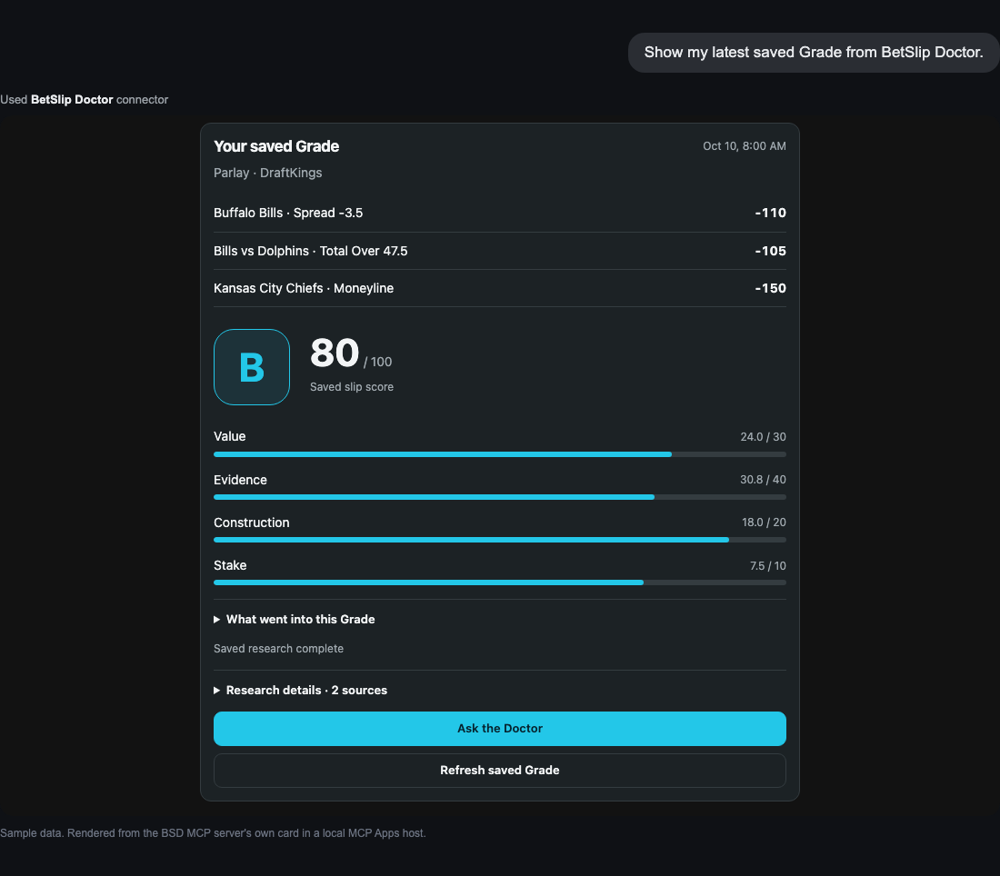

# BetSlip Doctor MCP server

**Bet slip grader, parlay tracker, bet tracker and Tail community for AI assistants.**
Connect Claude, ChatGPT, Cursor, VS Code, Gemini CLI or any MCP client to your own
[BetSlip Doctor](https://betslipdoctor.ai) account and ask, in plain words:
*"Grade this parlay before I bet it." "Show my record this month." "What's new on Tail?"*

```text
https://api.betslipdoctor.ai/api/mcp
```

Streamable HTTP. OAuth 2.1 with PKCE and dynamic client registration. This repository holds
docs, examples and client manifests only: no server code, no credentials.

## What it does

- **Grades a bet slip before you place it.** A letter from A+ to F-, a score out of 100
  (Value 30, Research 40, Slip construction 20, Stake fit 10) from up to 100 research
  questions in 10 groups, with sources. [How the grade system works](https://betslipdoctor.ai/grade-system).
- **Tracks parlays and singles.** Same-game parlays stay one pick with their legs inside;
  settlement keeps push, void, cash out and dead heat. [Parlay tracker](https://betslipdoctor.ai/parlay-tracker).
- **Reads your betting history.** Recorded profit and loss, win rate and the win-loss split
  for 1W, 1M, 3M, 1Y or All; CSV export. [Bet tracker](https://betslipdoctor.ai/bet-tracker).
- **Reads and posts to Tail**, the community where slips carry their Grade. Tail or fade a
  post into your own unplaced slip. [Tail community](https://betslipdoctor.ai/tail-community).
- **Talks to the Doctor** about any saved Grade, and can **fix a weak slip** in up to 3 moves.
- **Compares posted prices** at up to 5 sportsbooks and prepares a sportsbook link that
  opens only when you tap it.

46 tools. Full list: [TOOLS.md](TOOLS.md). Cards (saved Grade, Doctor conversation,
History chart, Tail post, saved slip) render inline in hosts that support MCP Apps.



## Connect

| Client | How |
| --- | --- |
| Claude (web, desktop) | Customize → Connectors → Add custom connector → paste the URL → Register automatically → sign in |
| ChatGPT | chatgpt.com/plugins → Add custom MCP server → Public endpoint → paste the URL → sign in |
| Claude Code | `claude plugin marketplace add opspot-ai/betslipdoctor-mcp` then `claude plugin install betslip-doctor@betslip-doctor` |
| Cursor | Settings → MCP → Add, or use `plugin.json` + `mcp.json` from this repo |
| VS Code | `code --add-mcp '{"name":"betslip-doctor","type":"http","url":"https://api.betslipdoctor.ai/api/mcp"}'` |
| Gemini CLI | `gemini extensions install https://github.com/opspot-ai/betslipdoctor-mcp` |
| Anything else | Streamable HTTP + OAuth discovery: [docs/connect.md](docs/connect.md) |

Step-by-step with pictures: https://betslipdoctor.ai/agents

## Who can use it

- A BetSlip Doctor account on the **Pro ($19.99/month) or Elite ($49.99/month)** plan for agent
  access. Plans and the free tier: https://betslipdoctor.ai/pricing
- Adults of legal sports-betting age in the United States (21+ in most states).

## What it will never do

Place a bet, move money, change billing or privacy settings, or ask for a sportsbook login.
Every Grade and Doctor job that spends allowance is quoted first. Outputs are entertainment
and decision support, never a guarantee or financial advice.
If gambling stops being fun, call 1-800-522-4700 (NCPG).

## Try it

[examples/prompts.md](examples/prompts.md) has prompts by task.
[examples/discovery.sh](examples/discovery.sh) lists the tools without signing in.

## Files

- `server.json`: the [MCP Registry](https://registry.modelcontextprotocol.io) manifest (`ai.betslipdoctor/mcp`).
- `llms.txt`: the same facts for language models ([live copy](https://betslipdoctor.ai/llms.txt)).
- `plugin.json`, `mcp.json`: Agent Plugins standard (Cursor, Codex).
- `.claude-plugin/`, `.mcp.json`: Claude Code plugin and marketplace.
- `gemini-extension.json`, `GEMINI.md`: Gemini CLI extension.
- `skills/bsd-workflow/SKILL.md`: how an agent should read, grade and post.
- `docs/`: connection guide, public HTTP API guide, screenshots (sample data).

Privacy: https://betslipdoctor.ai/privacy · Terms: https://betslipdoctor.ai/legal ·
Support: support@betslipdoctor.ai
